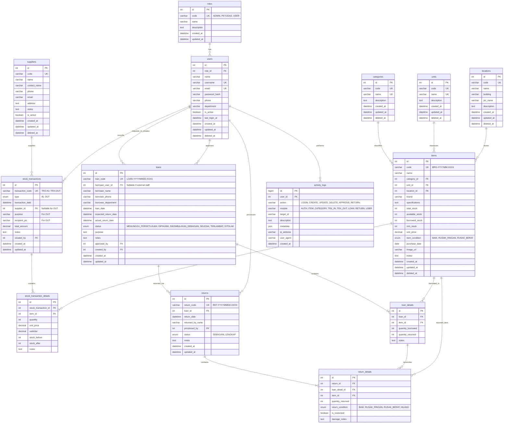

# DATABASE DESIGN & ENTITY RELATIONSHIP DIAGRAM (ERD)
## SISTEM INFORMASI MANAJEMEN INVENTARIS (MySQL)

Dokumen ini menjelaskan rancangan skema database **MySQL** untuk Sistem Informasi Manajemen Inventaris. Skema dirancang dengan normalisasi tingkat ketiga (3NF), integritas referensial penuh menggunakan **Foreign Key**, **Unique Constraints**, **Composite Indexing**, **Timestamps**, **Soft Delete**, serta mekanisme **ACID Database Transaction** untuk menjaga keakuratan stok barang.

---

## 1. Prinsip Integritas Stok & Audit
1. **Stok Terstruktur**: Setiap barang (`items`) menyimpan tiga indikator kuantitas yang selalu sinkron:
   - `total_stock`: Total fisik barang milik inventaris (tersedia + sedang dipinjam).
   - `available_stock`: Stok yang siap digunakan/dipinjam di lokasi penyimpanan.
   - `borrowed_stock`: Stok yang sedang berada di tangan peminjam aktif.
   - **Rumus Invarian**: `total_stock = available_stock + borrowed_stock` dan `available_stock >= 0`.
2. **Dilarang Mengubah Stok Tanpa Jejak Transaksi**:
   - **Barang Masuk (`IN`)**: `total_stock += qty`, `available_stock += qty`.
   - **Barang Keluar (`OUT`)**: Validasi `available_stock >= qty`, lalu `total_stock -= qty`, `available_stock -= qty`.
   - **Peminjaman Disetujui (`DIPINJAM`)**: Validasi `available_stock >= qty`, lalu `available_stock -= qty`, `borrowed_stock += qty` (`total_stock` tetap).
   - **Pengembalian Layak Pakai (`BAIK` / `RUSAK_RINGAN`)**: `borrowed_stock -= qty_returned`, `available_stock += qty_returned`.
   - **Pengembalian Rusak Berat / Hilang (`RUSAK_BERAT` / `HILANG`)**: `borrowed_stock -= qty_returned`, `total_stock -= qty_returned` (tercatat pada detail pengembalian & log audit).

---

## 2. Entity Relationship Diagram (ERD)

---

## 3. Spesifikasi Detail Tabel (15 Tabel)

### 3.1. Tabel `roles`
Menyimpan daftar hak akses dasar pengguna.
- `id` INT AUTO_INCREMENT PRIMARY KEY
- `code` VARCHAR(30) NOT NULL UNIQUE (`ADMIN`, `PETUGAS`, `USER`)
- `name` VARCHAR(50) NOT NULL
- `description` TEXT NULL
- `created_at` DATETIME DEFAULT CURRENT_TIMESTAMP
- `updated_at` DATETIME DEFAULT CURRENT_TIMESTAMP ON UPDATE CURRENT_TIMESTAMP

### 3.2. Tabel `users`
Menyimpan akun pengguna yang dapat mengakses sistem.
- `id` INT AUTO_INCREMENT PRIMARY KEY
- `role_id` INT NOT NULL, FOREIGN KEY (`role_id`) REFERENCES `roles`(`id`) ON UPDATE CASCADE ON DELETE RESTRICT
- `name` VARCHAR(100) NOT NULL
- `username` VARCHAR(50) NOT NULL UNIQUE
- `email` VARCHAR(100) NOT NULL UNIQUE
- `password_hash` VARCHAR(255) NOT NULL
- `phone` VARCHAR(30) NULL
- `department` VARCHAR(100) NULL
- `is_active` BOOLEAN NOT NULL DEFAULT TRUE
- `last_login_at` DATETIME NULL
- `created_at` DATETIME DEFAULT CURRENT_TIMESTAMP
- `updated_at` DATETIME DEFAULT CURRENT_TIMESTAMP ON UPDATE CURRENT_TIMESTAMP
- `deleted_at` DATETIME NULL (Soft Delete)
- **Indexes**: `idx_users_role_id`, `idx_users_active`

### 3.3. Tabel `categories`
Menyimpan kategori barang inventaris (Elektronik, Furniture, Alat Tulis Kantor, Kendaraan, Jaringan, dll.).
- `id` INT AUTO_INCREMENT PRIMARY KEY
- `code` VARCHAR(30) NOT NULL UNIQUE
- `name` VARCHAR(100) NOT NULL UNIQUE
- `description` TEXT NULL
- `created_at`, `updated_at`, `deleted_at`

### 3.4. Tabel `units`
Menyimpan satuan kuantitas barang (Unit, Pcs, Set, Box, Rim, Pack).
- `id` INT AUTO_INCREMENT PRIMARY KEY
- `code` VARCHAR(20) NOT NULL UNIQUE
- `name` VARCHAR(50) NOT NULL UNIQUE
- `description` TEXT NULL
- `created_at`, `updated_at`, `deleted_at`

### 3.5. Tabel `suppliers`
Menyimpan daftar pemasok / vendor barang.
- `id` INT AUTO_INCREMENT PRIMARY KEY
- `code` VARCHAR(30) NOT NULL UNIQUE
- `name` VARCHAR(150) NOT NULL
- `contact_name` VARCHAR(100) NOT NULL
- `phone` VARCHAR(30) NOT NULL
- `email` VARCHAR(100) NULL
- `address` TEXT NOT NULL
- `notes` TEXT NULL
- `is_active` BOOLEAN NOT NULL DEFAULT TRUE
- `created_at`, `updated_at`, `deleted_at`

### 3.6. Tabel `locations`
Menyimpan daftar lokasi penyimpanan barang.
- `id` INT AUTO_INCREMENT PRIMARY KEY
- `code` VARCHAR(30) NOT NULL UNIQUE
- `name` VARCHAR(100) NOT NULL
- `building` VARCHAR(100) NULL
- `pic_name` VARCHAR(100) NULL
- `description` TEXT NULL
- `created_at`, `updated_at`, `deleted_at`

### 3.7. Tabel `items`
Menyimpan master data barang inventaris.
- `id` INT AUTO_INCREMENT PRIMARY KEY
- `code` VARCHAR(40) NOT NULL UNIQUE (Kode otomatis, contoh: `BRG-202611-0001`)
- `name` VARCHAR(150) NOT NULL
- `category_id` INT NOT NULL, FOREIGN KEY REFERENCES `categories`(`id`) ON DELETE RESTRICT
- `unit_id` INT NOT NULL, FOREIGN KEY REFERENCES `units`(`id`) ON DELETE RESTRICT
- `location_id` INT NOT NULL, FOREIGN KEY REFERENCES `locations`(`id`) ON DELETE RESTRICT
- `brand` VARCHAR(100) NULL
- `specifications` TEXT NULL
- `total_stock` INT NOT NULL DEFAULT 0
- `available_stock` INT NOT NULL DEFAULT 0
- `borrowed_stock` INT NOT NULL DEFAULT 0
- `min_stock` INT NOT NULL DEFAULT 5
- `unit_price` DECIMAL(15, 2) NOT NULL DEFAULT 0.00
- `item_condition` ENUM('BAIK', 'RUSAK_RINGAN', 'RUSAK_BERAT') NOT NULL DEFAULT 'BAIK'
- `purchase_date` DATE NULL
- `image_url` VARCHAR(255) NULL
- `notes` TEXT NULL
- `created_at`, `updated_at`, `deleted_at`
- **Indexes**: `idx_items_category`, `idx_items_location`, `idx_items_name`, `idx_items_stock`

### 3.8. Tabel `stock_transactions`
Header untuk transaksi Barang Masuk (`IN`) dan Barang Keluar (`OUT`).
- `id` INT AUTO_INCREMENT PRIMARY KEY
- `transaction_code` VARCHAR(40) NOT NULL UNIQUE (`TRX-IN-YYYYMMDD-XXXX` / `TRX-OUT-YYYYMMDD-XXXX`)
- `type` ENUM('IN', 'OUT') NOT NULL
- `transaction_date` DATETIME NOT NULL
- `supplier_id` INT NULL, FOREIGN KEY REFERENCES `suppliers`(`id`) ON DELETE SET NULL (Digunakan pada transaksi `IN`)
- `purpose` VARCHAR(255) NULL (Tujuan penggunaan pada transaksi `OUT`)
- `recipient_pic` VARCHAR(100) NULL (Penanggung jawab pada transaksi `OUT`)
- `total_amount` DECIMAL(15, 2) NOT NULL DEFAULT 0.00
- `notes` TEXT NULL
- `created_by` INT NOT NULL, FOREIGN KEY REFERENCES `users`(`id`) ON DELETE RESTRICT
- `created_at`, `updated_at`
- **Indexes**: `idx_stock_trx_type_date`, `idx_stock_trx_supplier`

### 3.9. Tabel `stock_transaction_details`
Rincian barang pada setiap transaksi Barang Masuk / Keluar.
- `id` INT AUTO_INCREMENT PRIMARY KEY
- `stock_transaction_id` INT NOT NULL, FOREIGN KEY REFERENCES `stock_transactions`(`id`) ON DELETE CASCADE
- `item_id` INT NOT NULL, FOREIGN KEY REFERENCES `items`(`id`) ON DELETE RESTRICT
- `quantity` INT NOT NULL
- `unit_price` DECIMAL(15, 2) NOT NULL DEFAULT 0.00
- `subtotal` DECIMAL(15, 2) NOT NULL DEFAULT 0.00
- `stock_before` INT NOT NULL
- `stock_after` INT NOT NULL
- `notes` TEXT NULL

### 3.10. Tabel `loans`
Header transaksi peminjaman barang inventaris.
- `id` INT AUTO_INCREMENT PRIMARY KEY
- `loan_code` VARCHAR(40) NOT NULL UNIQUE (`LOAN-YYYYMMDD-XXXX`)
- `borrower_user_id` INT NULL, FOREIGN KEY REFERENCES `users`(`id`) ON DELETE SET NULL
- `borrower_name` VARCHAR(100) NOT NULL
- `borrower_phone` VARCHAR(30) NULL
- `borrower_department` VARCHAR(100) NULL
- `loan_date` DATETIME NOT NULL
- `expected_return_date` DATETIME NOT NULL
- `actual_return_date` DATETIME NULL
- `status` ENUM('MENUNGGU_PERSETUJUAN', 'DIPINJAM', 'DIKEMBALIKAN_SEBAGIAN', 'SELESAI', 'TERLAMBAT', 'DITOLAK') NOT NULL DEFAULT 'MENUNGGU_PERSETUJUAN'
- `purpose` VARCHAR(255) NOT NULL
- `notes` TEXT NULL
- `approved_by` INT NULL, FOREIGN KEY REFERENCES `users`(`id`) ON DELETE SET NULL
- `created_by` INT NOT NULL, FOREIGN KEY REFERENCES `users`(`id`) ON DELETE RESTRICT
- `created_at`, `updated_at`
- **Indexes**: `idx_loans_status`, `idx_loans_dates`, `idx_loans_borrower`

### 3.11. Tabel `loan_details`
Rincian barang yang dipinjam dalam satu transaksi peminjaman.
- `id` INT AUTO_INCREMENT PRIMARY KEY
- `loan_id` INT NOT NULL, FOREIGN KEY REFERENCES `loans`(`id`) ON DELETE CASCADE
- `item_id` INT NOT NULL, FOREIGN KEY REFERENCES `items`(`id`) ON DELETE RESTRICT
- `quantity_borrowed` INT NOT NULL
- `quantity_returned` INT NOT NULL DEFAULT 0
- `notes` TEXT NULL

### 3.12. Tabel `returns`
Header pencatatan pengembalian barang pinjaman.
- `id` INT AUTO_INCREMENT PRIMARY KEY
- `return_code` VARCHAR(40) NOT NULL UNIQUE (`RET-YYYYMMDD-XXXX`)
- `loan_id` INT NOT NULL, FOREIGN KEY REFERENCES `loans`(`id`) ON DELETE RESTRICT
- `return_date` DATETIME NOT NULL
- `returned_by_name` VARCHAR(100) NOT NULL
- `processed_by` INT NOT NULL, FOREIGN KEY REFERENCES `users`(`id`) ON DELETE RESTRICT
- `status` ENUM('SEBAGIAN', 'LENGKAP') NOT NULL
- `notes` TEXT NULL
- `created_at`, `updated_at`

### 3.13. Tabel `return_details`
Rincian kondisi dan jumlah per barang saat dikembalikan.
- `id` INT AUTO_INCREMENT PRIMARY KEY
- `return_id` INT NOT NULL, FOREIGN KEY REFERENCES `returns`(`id`) ON DELETE CASCADE
- `loan_detail_id` INT NOT NULL, FOREIGN KEY REFERENCES `loan_details`(`id`) ON DELETE RESTRICT
- `item_id` INT NOT NULL, FOREIGN KEY REFERENCES `items`(`id`) ON DELETE RESTRICT
- `quantity_returned` INT NOT NULL
- `return_condition` ENUM('BAIK', 'RUSAK_RINGAN', 'RUSAK_BERAT', 'HILANG') NOT NULL DEFAULT 'BAIK'
- `is_restocked` BOOLEAN NOT NULL DEFAULT TRUE
- `damage_notes` TEXT NULL

### 3.14. Tabel `activity_logs`
Audit trail seluruh aktivitas pengguna di dalam sistem.
- `id` BIGINT AUTO_INCREMENT PRIMARY KEY
- `user_id` INT NULL, FOREIGN KEY REFERENCES `users`(`id`) ON DELETE SET NULL
- `action` VARCHAR(50) NOT NULL
- `module` VARCHAR(50) NOT NULL
- `target_id` VARCHAR(50) NULL
- `description` TEXT NOT NULL
- `metadata` JSON NULL
- `ip_address` VARCHAR(45) NULL
- `user_agent` VARCHAR(255) NULL
- `created_at` DATETIME DEFAULT CURRENT_TIMESTAMP
- **Indexes**: `idx_logs_user_date`, `idx_logs_module`

### 3.15. Tabel `system_settings`
Menyimpan pengaturan aplikasi dan profil organisasi untuk kop laporan.
- `id` INT AUTO_INCREMENT PRIMARY KEY
- `setting_key` VARCHAR(50) NOT NULL UNIQUE
- `setting_value` TEXT NOT NULL
- `updated_at` DATETIME DEFAULT CURRENT_TIMESTAMP ON UPDATE CURRENT_TIMESTAMP
