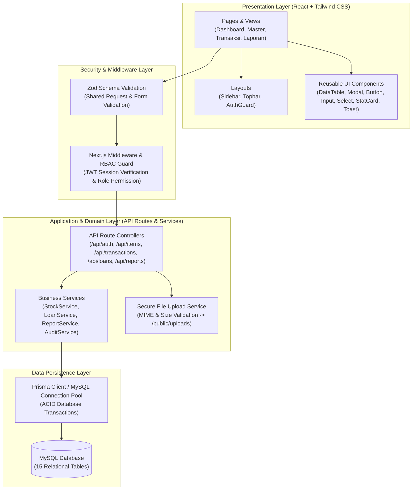
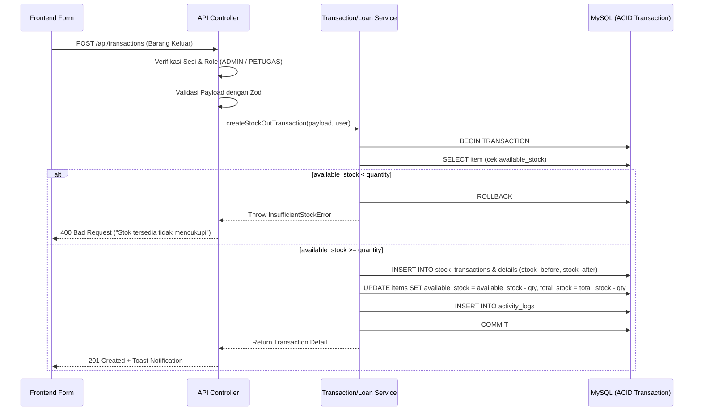

# SYSTEM ARCHITECTURE — SISTEM INFORMASI MANAJEMEN INVENTARIS

Dokumen ini menjelaskan arsitektur perangkat lunak, pembagian lapisan modul, mekanisme keamanan, dan alur transaksi pada aplikasi **SIM-INVENTARIS**.

---

## 1. Gambaran Umum Arsitektur

Aplikasi dibangun menggunakan arsitektur **Full-Stack Modular Monolith** berbasis **Next.js (App Router) + TypeScript + Prisma ORM + MySQL**. Pemisahan tanggung jawab (*Separation of Concerns*) diterapkan secara ketat antara lapisan presentasi (UI), validasi, kontroler API, layanan bisnis (*business logic & database transactions*), dan akses data.



---

## 2. Struktur Direktori Proyek (Modular & Scalable)

Sesuai standar kualitas pada spesifikasi proyek, kode dipisahkan ke dalam direktori fungsional yang jelas:

```text
web-umkm/
├── prisma/
│   ├── schema.prisma              # Definisi skema MySQL, relasi FK, dan index
│   └── seed.ts                    # Data awal (Roles, Users, Kategori, Satuan, Lokasi, Supplier, Barang, Transaksi)
├── public/
│   └── uploads/items/             # Penyimpanan gambar barang yang diunggah
├── src/
│   ├── app/                       # Next.js App Router (Pages & API Endpoints)
│   │   ├── (auth)/login/          # Halaman Login
│   │   ├── (dashboard)/           # Grup halaman terproteksi dengan DashboardLayout
│   │   │   ├── dashboard/         # 1. Dashboard Analitik
│   │   │   ├── master/
│   │   │   │   ├── items/         # 2a. Data Barang
│   │   │   │   ├── categories/    # 2b. Kategori Barang
│   │   │   │   ├── units/         # 2c. Satuan Barang
│   │   │   │   ├── suppliers/     # 2d. Supplier
│   │   │   │   └── locations/     # 2e. Lokasi Barang
│   │   │   ├── transactions/
│   │   │   │   ├── incoming/      # 3a. Barang Masuk
│   │   │   │   ├── outgoing/      # 3b. Barang Keluar
│   │   │   │   ├── loans/         # 3c. Peminjaman Barang
│   │   │   │   └── returns/       # 3d. Pengembalian Barang
│   │   │   ├── reports/           # 4. Laporan (Stok, Masuk, Keluar, Peminjaman, Pengembalian)
│   │   │   ├── users/             # 5. Manajemen User (Admin Only)
│   │   │   ├── activity-logs/     # 6. Riwayat Aktivitas / Audit Log
│   │   │   └── settings/          # 7. Pengaturan Sistem & Profil
│   │   └── api/                   # Backend REST API Endpoints
│   │       ├── auth/              # login, logout, me, password
│   │       ├── dashboard/         # Metrik real-time & grafik Recharts
│   │       ├── items/             # CRUD barang & upload gambar
│   │       ├── categories/        # CRUD kategori + proteksi relasi
│   │       ├── units/             # CRUD satuan + proteksi relasi
│   │       ├── suppliers/         # CRUD supplier
│   │       ├── locations/         # CRUD lokasi
│   │       ├── transactions/      # Transaksi Barang Masuk (IN) & Keluar (OUT)
│   │       ├── loans/             # Pengajuan, persetujuan, dan daftar peminjaman
│   │       ├── returns/           # Proses pengembalian & rekonsiliasi stok
│   │       ├── reports/           # Query laporan terfilter (Stok, Masuk, Keluar, Pinjam, Kembali)
│   │       ├── users/             # CRUD manajemen user & role
│   │       ├── activity-logs/     # Query audit log
│   │       └── settings/          # Konfigurasi instansi & profil
│   ├── components/
│   │   ├── ui/                    # Reusable UI Components:
│   │   │   ├── Button.tsx
│   │   │   ├── Input.tsx
│   │   │   ├── Select.tsx
│   │   │   ├── Modal.tsx
│   │   │   ├── DataTable.tsx
│   │   │   ├── Pagination.tsx
│   │   │   ├── SearchFilterBar.tsx
│   │   │   ├── StatCard.tsx
│   │   │   ├── ConfirmDialog.tsx
│   │   │   ├── Badge.tsx
│   │   │   └── Toast.tsx
│   │   └── layouts/
│   │       ├── Sidebar.tsx        # Navigasi kiri dengan menu bertingkat & filter role
│   │       ├── Topbar.tsx         # Informasi user aktif, badge role, quick info
│   │       └── DashboardShell.tsx # Wrapper responsif desktop/tablet/mobile
│   ├── controllers/               # Handler logika request/response API
│   ├── services/                  # Business Logic & Database Transactions (ACID)
│   │   ├── auth.service.ts
│   │   ├── item.service.ts
│   │   ├── master.service.ts
│   │   ├── transaction.service.ts
│   │   ├── loan.service.ts
│   │   ├── return.service.ts
│   │   ├── report.service.ts
│   │   └── audit.service.ts
│   ├── database/
│   │   └── prisma.ts              # Singleton Prisma Client instance
│   ├── models/                    # Domain model helpers & DTO mappers
│   ├── middleware/
│   │   └── auth-guard.ts          # Verifikasi session & RBAC permission di API
│   ├── validation/                # Skema Zod (Auth, Item, Master, Transaction, Loan, Return, User)
│   ├── utilities/                 # Code generator (BRG/TRX/LOAN/RET), formatters (Rupiah, Tanggal), Export PDF/Excel
│   ├── types/                     # TypeScript interfaces & shared types
│   └── middleware.ts              # Next.js Edge Middleware untuk proteksi halaman
```

---

## 3. Arsitektur Keamanan & Role-Based Access Control (RBAC)

1. **Password Hashing**:
   - Seluruh password di-hash menggunakan `bcryptjs` (salt rounds = 10) sebelum disimpan di kolom `password_hash`. Password plaintext tidak pernah disimpan atau dikembalikan oleh API.
2. **Session & Authentication**:
   - Saat login berhasil, server menerbitkan token sesi terenkripsi (`HS256` menggunakan library `jose`) yang disimpan di dalam `HTTP-Only, SameSite=Lax` Cookie.
   - Proteksi rute halaman dilakukan oleh `src/middleware.ts`, sedangkan proteksi setiap endpoint API dilakukan oleh helper `withAuth(req, allowedRoles)` pada `src/middleware/auth-guard.ts`.
3. **Double-Layer Validation (Frontend & Backend)**:
   - Skema `Zod` dijalankan pada form sebelum dikirim dan dijalankan ulang di sisi backend API sebelum menyentuh layanan database.
4. **Proteksi SQL Injection & XSS**:
   - Seluruh kueri menggunakan *parameterized queries* melalui Prisma ORM.
   - Seluruh output di-escape secara otomatis oleh React, ditambah sanitasi input string pada validasi Zod.
5. **Validasi Upload File Gambar Barang**:
   - Membatasi tipe MIME hanya untuk gambar (`image/jpeg`, `image/png`, `image/webp`) dan ukuran maksimal `2 MB`. Nama file di-randomisasi dengan timestamp/UUID yang aman untuk mencegah *path traversal*.
6. **Audit Trail (`activity_logs`)**:
   - Setiap aksi mutasi penting otomatis mencatat `user_id`, `action`, `module`, `target_id`, `description`, `metadata`, dan `ip_address` di dalam transaksi database yang sama.

---

## 4. Alur Atomisitas Transaksi Stok (`Database Transaction`)

Untuk menjamin stok tidak pernah korup atau negatif pada kondisi *concurrent request*, seluruh mutasi stok dieksekusi di dalam blok `prisma.$transaction(async (tx) => { ... })`:



---

## 5. Desain UI/UX (Enterprise SaaS Dashboard)

- **Palet Warna**:
  - Background utama: `Slate-50` (`#f8fafc`), Surface/Card: `White` (`#ffffff`) dengan border halus `Slate-200` (`#e2e8f0`).
  - Navigasi Sidebar: `Slate-900` (`#0f172a`) dengan item aktif `Blue-600` (`#2563eb`).
  - Status Semantik:
    - `Emerald-600` (Stok Aman / Selesai / Barang Masuk)
    - `Amber-600` (Menunggu Persetujuan / Dikembalikan Sebagian / Stok Menipis)
    - `Rose-600` (Stok Kritis / Barang Keluar / Terlambat / Rusak Berat)
    - `Blue-600` (Sedang Dipinjam / Aksi Utama)
- **Komponen Interaktif**:
  - Setiap tabel memiliki **Search Bar**, **Dropdown Filter**, **Indikator Jumlah Data**, **Pagination**, **Loading Skeleton**, dan **Empty State** informatif.
  - Seluruh aksi hapus atau perubahan status krusial dilengkapi **Confirmation Dialog** untuk mencegah kesalahan klik oleh pengguna.
